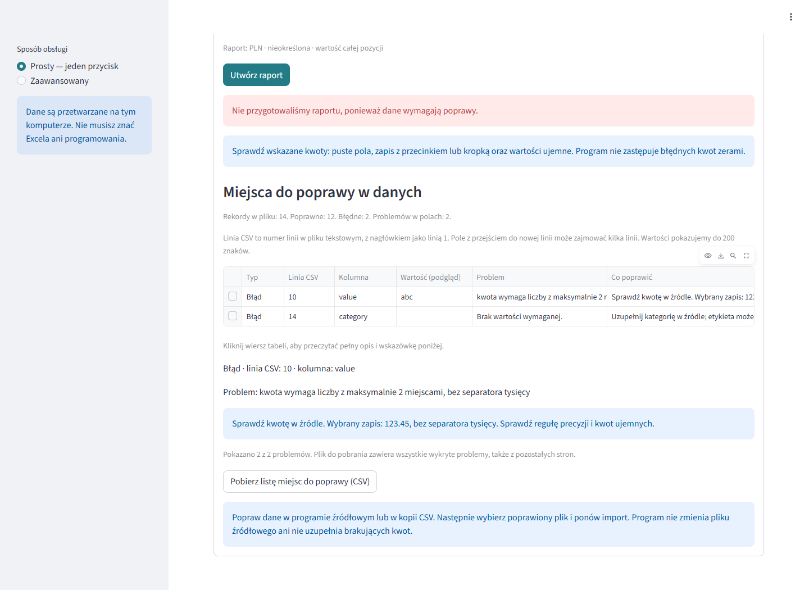
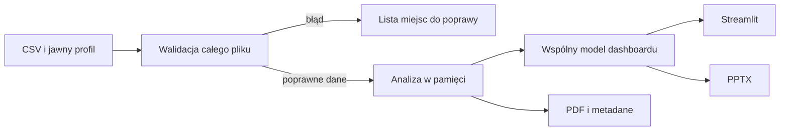

# Auto-Report

**Lokalna aplikacja Windows: CSV → kontrola danych → dashboard → PDF / PowerPoint.**

Projekt portfolio pokazujący import danych, dokładne obliczenia pieniężne,
diagnostykę błędów i dostarczenie aplikacji użytkownikowi bez instalacji Pythona.
Przykłady i demonstracja korzystają wyłącznie ze sztucznych danych.

## Pobierz i wypróbuj

| Wersja | Pobieranie | Status |
|---|---|---|
| **2 - bieżąca aplikacja** | [Windows ZIP](https://github.com/Vulpiss/Auto-Report/releases/download/v0.2.0-beta.1/AutoReportAnalyst-Windows-2026-10-06-hardening.zip) · [opis wydania](https://github.com/Vulpiss/Auto-Report/releases/tag/v0.2.0-beta.1) | **Beta / pre-release**, do kontrolowanych testów |
| **1 - początkowe MVP** | [kod i opis archiwalnego wydania](https://github.com/Vulpiss/Auto-Report/releases/tag/v0.1.0) · [instrukcja wersji 1](docs/LEGACY_MVP.md) | Archiwum z 21.06.2026, do porównania rozwoju |

[Test wersji 2 krok po kroku](docs/TRY_IT.md) ·
[Różnice między wersjami](docs/RELEASES.md) ·
[Sumy SHA-256 paczek](https://github.com/Vulpiss/Auto-Report/releases/download/v0.2.0-beta.1/SHA256SUMS.txt)

Numer `v0.2.0-beta.1` identyfikuje publiczne wydanie testowe. Wersja wewnętrzna
aplikacji to `0.2.0`. ZIP zachowuje sprawdzony runtime z 2026-10-06; ta
publikacja dodaje aktualny kod, testy i instrukcje do repozytorium.


**[Obejrzyj demonstrację](docs/portfolio/media/demo.mp4)** ·
[Opis projektu i decyzji technicznych](docs/portfolio/CASE_STUDY.md) ·
[Przykładowy PDF](docs/portfolio/demo-report.pdf) ·
[Weryfikacja bieżącego wydania](docs/LOCAL_HARDENING_RESULTS.md)

Nagranie i wzorcowy PDF powstały dla wydania portfolio 2026-10-04.
Bieżące wydanie ma szablon PDF 4 oraz nowe kontrole odporności.

## Uruchomienie na Windows

Aktualne wydanie: **`AutoReportAnalyst-Windows-2026-10-06-hardening.zip`**
do pobrania z [GitHub Releases](https://github.com/Vulpiss/Auto-Report/releases/tag/v0.2.0-beta.1).
Lokalne kompilacje pozostają w katalogu `release/`; pliki EXE i ZIP są
załącznikami wydania i nie są przechowywane w historii kodu Git.

1. Rozpakuj cały ZIP, zachowując folder `_internal` obok `AutoReportAnalyst.exe`.
2. Uruchom `AutoReportAnalyst.exe`; launcher uruchamia lokalny serwer i otwiera przeglądarkę.
3. Zaznacz „Chcę najpierw wypróbować program na przykładzie” i kliknij „Utwórz raport”.
4. Oczekiwany wynik całego przykładu: **2 250,00 PLN, 14 pozycji, średnia 160,71 PLN**.
5. PDF przygotowuje się automatycznie. Zakończ aplikację przyciskiem „Zakończ program” w małym oknie.

Przeglądarka komunikuje się z aplikacją na `127.0.0.1`. Dla pierwszego
własnego eksportu trzeba potwierdzić znaczenie kolumn, format dat i kwot oraz
walutę. Kolejne zgodne pliki korzystają z zapamiętanego profilu.

[Pełna instrukcja](docs/ANALYST_QUICKSTART.md) · [Scenariusz demonstracji](docs/portfolio/DEMO.md)

## Uruchomienie z kodu

Python 3.11, Windows. W katalogu repozytorium:

```powershell
py -3.11 -m venv .venv
.\.venv\Scripts\python.exe -m pip install -r requirements-dashboard.txt
.\.venv\Scripts\python.exe dashboard_entry.py
```

Przy pracy nad interfejsem można uruchomić sam serwer:

```powershell
.\.venv\Scripts\python.exe -m streamlit run interfaces/simple_app.py --server.address=127.0.0.1 --server.headless=true --browser.gatherUsageStats=false
```

W drugim wariancie otwórz adres lokalny wskazany w terminalu; `Ctrl+C` kończy serwer.
`interfaces/desktop_app.py` i `main.py` są wcześniejszymi punktami wejścia.
Głównym wejściem bieżącej wersji jest `dashboard_entry.py`.

## Co pokazuje projekt

- Jeden wspólny wynik analizy dla dashboardów i eksportu PDF.
- Trzy widoki: wynik i trend, kategorie, jakość i pokrycie danych.
- Dwa sposoby obsługi: prosty i zaawansowany; pamięć profili importu.
- Kwoty w całkowitych setnych jednostki i `Decimal`; jawne reguły zaokrągleń.
- Diagnostyka: linia CSV, kolumna, wartość, przyczyna i wskazówka poprawy;
  pobieranie wszystkich wykrytych problemów do CSV.
- Porównanie okresów wymagające deklaracji kompletności; `N/A` z przyczyną,
  gdy brakuje podstaw do obliczenia.
- PDF z polskimi znakami oraz PPTX, także z natywnymi wykresami i osadzonymi danymi.
- Oddzielne katalogi eksportu, skrót SHA-256 źródła i zachowanie wcześniejszych raportów.



## Kontrakt i granice

Podstawowy profil wymaga **daty, wartości pozycji i kategorii**. Nazwy kolumn,
separator, kodowanie i formaty są konfigurowane jawnie. Wartość może być kwotą
całej pozycji albo iloczynem ceny i ilości. Ilość w drugim wariancie jest wymagana.

Import: do **100 MiB i 1 000 000 rekordów**. Jeden raport: do **pięciu lat
kalendarzowych**, zgodnie z granicą opisaną w [kontrakcie danych](docs/DATA_CONTRACT.md).
Limit techniczny nie jest gwarancją wydajności każdego pliku na dowolnym komputerze.

Jedna zadeklarowana waluta: PLN, EUR, USD, GBP lub nieokreślona jednostka j.p.
Program nie przelicza walut ani podatku. Wiersz nie jest automatycznie zamówieniem,
a suma kwot nie jest automatycznie przychodem. Powtórzenia pozostają w danych.
Błędne kwoty blokują raport i nigdy nie stają się zerem.

Pamięć profili zawiera ustawienia, bez wierszy CSV i deklaracji kompletności.
Wyniki analizy powstają w pamięci. Przy eksporcie aplikacja zapisuje PDF, wykres
i podsumowanie w wybranym katalogu; nie wymaga bazy danych klienta.
Komentarze są generowane deterministycznie, bez sieciowego LLM.

## Architektura



Kod: [walidacja](app/validation.py), [analiza](app/analysis.py),
[model widoków](app/dashboard_model.py), [eksport PDF](app/pipeline.py),
[interfejs](interfaces/simple_app.py), [launcher](dashboard_entry.py).
Warstwa SQLite w `app/transform.py` i `app/queries.py` obsługuje wcześniejsze
adaptery; bieżący dashboard analizuje zwalidowane rekordy w pamięci.

## Testy i kompilacja

```powershell
.\.venv\Scripts\python.exe -m pip install -r requirements-qa.txt
.\.venv\Scripts\python.exe -m unittest discover -s tests -v
```

Wzorce obejmują niezależnie policzone sumy, średnie i procenty, błędne i brakujące
pola, granice dat, brak podstaw do porównania, duży import oraz interfejsy.
**146 testów** przeszło w pełnej regresji kodu 2026-10-14; osiem nowych dotyczy
odbioru względem niezależnego wzorca. [Wyniki i granice](docs/first-test/TEST_RESULTS.md).
Regresję **146/146** powtórzono 2026-10-19 przed publikacją wersji beta;
[zakres kontroli publikacji](docs/GITHUB_RELEASE_2026-10-19.md).
EXE z 2026-10-06 pozostał bez zmian; jego kontrole opisuje
[protokół odporności](docs/LOCAL_HARDENING_RESULTS.md).

Jedno polecenie kontroli i kompilacji tworzy osobne środowisko z przypiętymi
zależnościami, uruchamia regresję, buduje EXE i sprawdza rozpakowany ZIP w Edge:

```powershell
.\.venv\Scripts\python.exe scripts/release_local.py --release-tag moja-wersja --date RRRR-MM-DD
```

Gotowy katalog i ZIP znajdziesz w `release/`. Tag wybiera osobne wydanie;
ponowne użycie tego samego tagu jest odrzucane. Potrzebne są Node,
Playwright z Edge i dostęp do pakietów; szczegóły w protokole odporności.
Niskopoziomowa kompilacja pozostaje w `scripts/build_analyst.py`.
Materiały portfolio odtwarza [skrypt demonstracji](scripts/prepare_portfolio.py);
wymagane dodatkowe narzędzia są opisane w scenariuszu demonstracji.

## Status i ograniczenia dowodów

**POTWIERDZONE:** działanie i zgodność liczb w opisanych testach, demonstracja
na danych sztucznych, lokalny serwer EXE oraz przygotowanie eksportów.

**HIPOTEZA:** zastosowanie do cyklicznego raportowania w małej hurtowni.

**UNKNOWN:** popyt, oszczędność czasu u klienta, opłacalność wdrożenia,
samodzielne użycie przez nowego użytkownika i uruchomienie na czystym Windowsie.
Portfolio techniczne jest oddzielone od walidacji oferty handlowej.

[Bieżący stan projektu](docs/IMPLEMENTATION_STATUS.md) ·
[Historia audytu](docs/BASELINE_AUDIT.md) ·
[Roboczy plan produktu i oferty](docs/HORMOZI_EXECUTION_PLAN.md)

[Pakiet pierwszego testu: VM, użytkownik, eksport i pilot](docs/first-test/START_HERE.md).
Materiały są przygotowane; czysty Windows i rzeczywisty pilot pozostają UNKNOWN.

Starsze raporty i wydania pozostają materiałem historycznym. Wcześniejszy README
zachowano w `docs/history/`. Licencja: [MIT](LICENSE).
