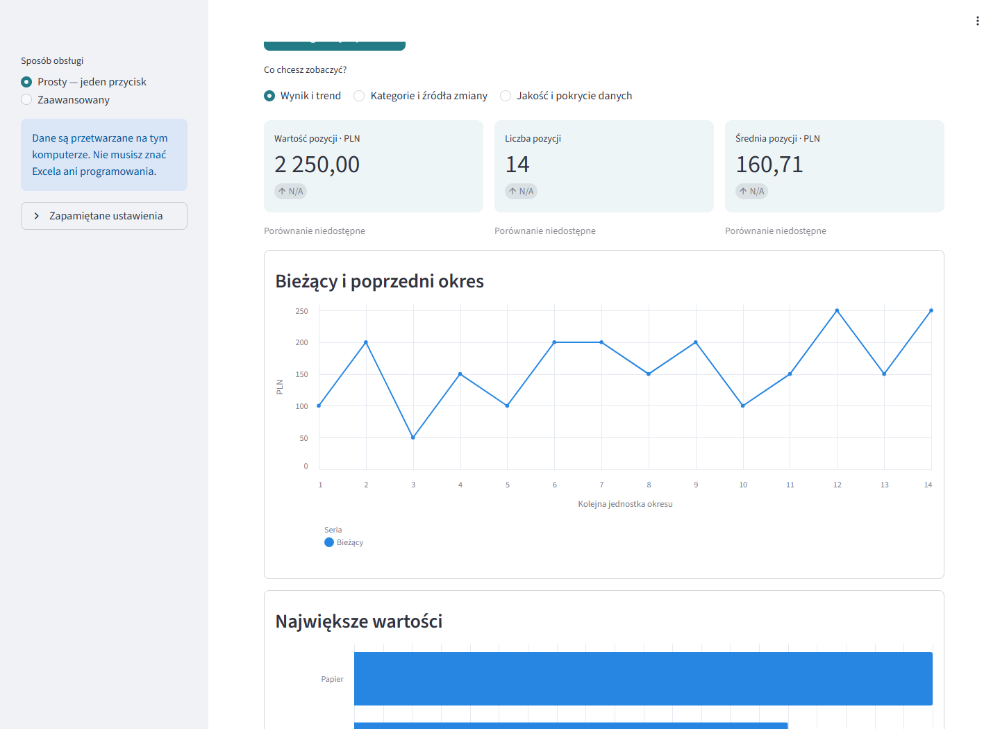

# Auto-Report — portfolio

Wydanie: **{{RELEASE_ZIP}}**. Przykłady korzystają ze sztucznych danych.

1. Rozpakuj cały ZIP i zachowaj `_internal` obok `AutoReportAnalyst.exe`.
2. Uruchom EXE, zaznacz przykład i kliknij „Utwórz raport”.
3. Cały przykład: **2 250,00 PLN, 14 pozycji, średnia 160,71 PLN**.
4. PDF przygotowuje się automatycznie. Po pracy użyj „Zakończ program” w launcherze.

[Obejrzyj demonstrację](portfolio/media/demo.mp4) ·
[Opis projektu](portfolio/CASE_STUDY.md) ·
[Przykładowy PDF](portfolio/demo-report.pdf) ·
[Weryfikacja](portfolio/VERIFICATION.md)

[Instrukcja](ANALYST_QUICKSTART.md) ·
[Diagnostyka](DATA_DIAGNOSTICS.md) ·
[Kontrakt danych](DATA_CONTRACT.md) · [Licencja MIT](LICENSE)

Limit: 100 MiB, 1 000 000 rekordów, do pięciu lat kalendarzowych w raporcie.
Pierwszy własny eksport wymaga konfiguracji. Błędne kwoty blokują raport.
Przetwarzanie odbywa się na tym komputerze; raport opisuje dostępne pozycje.

POTWIERDZONE: lokalne kontrole opisane w protokole weryfikacji.
HIPOTEZA: zastosowanie do raportowania w małej hurtowni.
UNKNOWN: wynik u klienta, samodzielność nowego użytkownika i czysty Windows.
